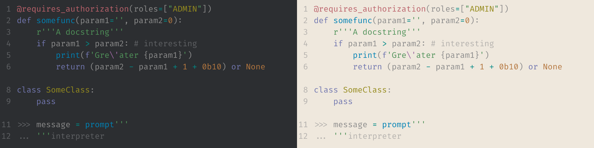
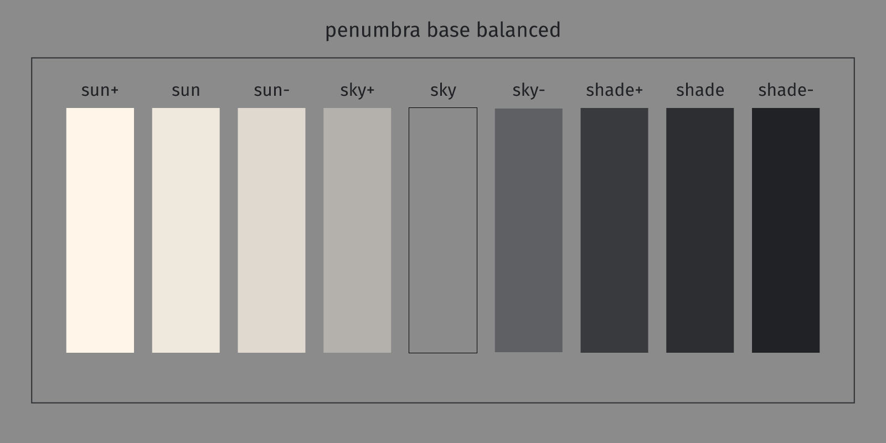
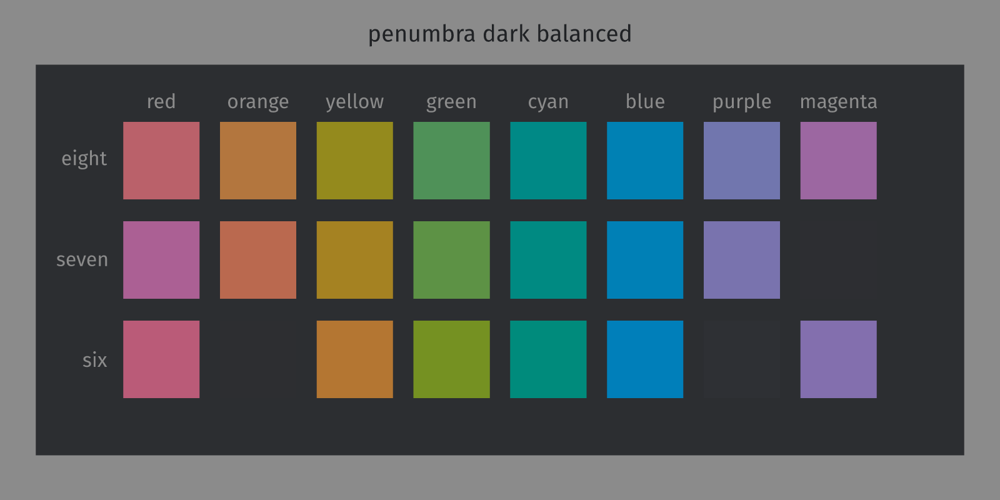
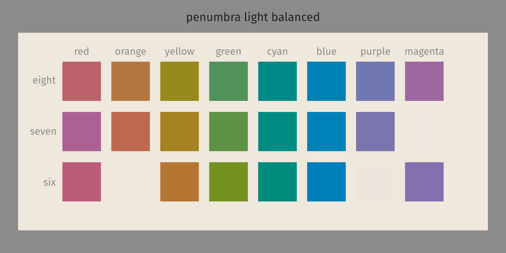
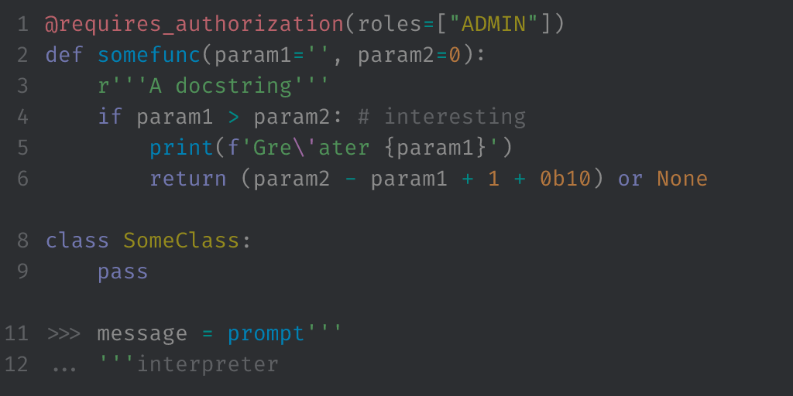
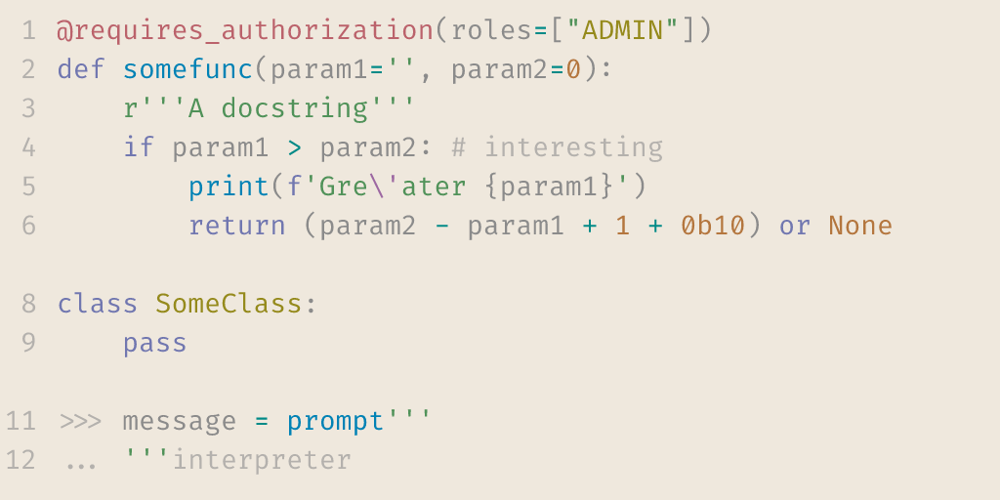
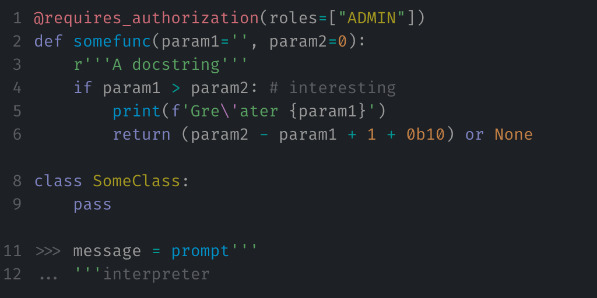
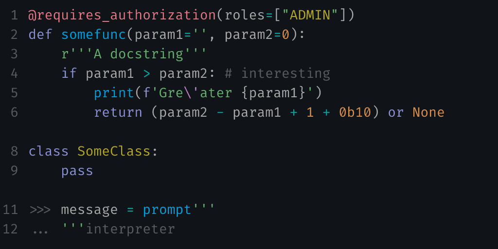

# VS Code Theme Using the Penumbra Colour Scheme

Penumbra is an ergonomically designed, mathematically balanced colour scheme constructed in a perceptually uniform colour appearance space for customizable user interfaces and text editors. It cleanly separates the perceptual properties of colour (lightness, chroma and hue) while optimally utilizing the available colour space of typical displays.

The nine base colours follow the natural transition of daylight from sunlit surfaces through neutral daylight into cool sky-lit shade. They are used to build the main light and dark themes, alongside two variants of the dark theme with enhanced contrast (`Penumbra Dark Contrast+` and `Penumbra Dark Contrast++`), ideal for bright ambient environments or anyone with mild to moderate visual impairments. Due to the constraints of the design principles, none of the variants are suitable for people with colour vision deficiency.

## Features

The goal of this colour scheme is to cleanly separate the use of each of the three perceptual properties of colour (lightness, chroma and hue) and optimally utilize the typically available colour space to encode information with each of them. Ergonomics and function are put before aesthetics, though the base colours modelled after natural daylight and low but sufficient contrast attempt to make the overall scheme pleasing to the eye.

### 1. Biophilic Base Colours

Human vision evolved outdoors under natural daylight, where sunlit surfaces are warm and shadows are cooled by diffuse light from the sky. Penumbra's base colours follow the CIE daylight locus continuously from warm direct sunlight through neutral daylight (CIE D65, the standard white point of consumer displays) into cool sky shade. Dark colours appearing like open shade and light colours like sunlit matte paper create a familiar, biophilic visual environment that fades into the background as that is what you are used to when going outside.

### 2. Just Enough Contrast

In psychophysical reading studies, reading speed reaches near-maximal levels around a luminance ratio of 3:1 – the minimum display legibility threshold specified in ISO-9241-3 – with strongly diminishing returns above it. While legibility is important to reduce eye strain, for many people, excessive contrast on dense, repetitive lines of text also contributes to visual stress and pattern glare. Penumbra places its main text-to-background contrast right at this threshold, with two enhanced contrast dark variants (`Contrast+` and `Contrast++`) available when ambient lighting or eyesight call for greater separation. The enhanced contrast tiers both lower `shade` and lift `sky` symmetrically while re-anchoring the daylight curve so text stays neutral CIE D65 (`6504 K`).

### 3. Fluidly Readable Code and Semantic Highlighting

Resolving fine character shapes and tracking smoothly along a line of text rely primarily on luminance contrast, whereas chroma and hue excel at visual search and grouping across the page. Because the main text and all accent colours share the same perceived lightness within the colour appearance model, it is easier to read code like continuous text and follow logical structure without brightness differences between words disrupting the flow, while maintaining the ability to scan for highlighted tokens.

The VS Code themes pair full LSP semantic token support with Penumbra's 8-colour accent palette for syntax highlighting and upright typography (avoiding italics), while integrated terminal ANSI colours (`terminal.ansi*`) use the equally spaced 6-colour palette for maximum hue separation. Variables, parameters and punctuation remain in neutral foreground grey (`sky`) so semantic landmarks stand out without chromatic clutter, and comments are de-emphasized purely through reduced lightness contrast (`sky-` / `sky+`).

### 4. Optimal Hue Differentiability

By using the [Revised CAM16-UCS](https://doi.org/10.1002/col.22792) colour appearance model together with its [Helmholtz–Kohlrausch extension](https://doi.org/10.1002/col.22793), Penumbra achieves equal perceptual hue steps and equal modelled brightness across all accent colours, adapted separately for dark and light backgrounds. Saturated colours appear brighter to the human eye than a neutral grey of the same physical luminance (the Helmholtz–Kohlrausch effect); compensating for this effect ensures that none of the accent colours stand out from or recede into the page more than others.

### 5. Maximized Gamut Chroma

Within the constraints of equal hue spacing and uniform perceived lightness, the hue rotation of each discrete palette polygon is chosen to maximize its constant chroma along the exact sRGB gamut boundary. This preserves maximum chroma and categorical discriminability across all eight syntax hues and six terminal ANSI hues without sacrificing brightness balance.

## Examples

### Dark

### Light

### Dark Contrast+

### Dark Contrast++

## Also Available For

Terminal emulators (iTerm2, Ghostty, Kitty, Alacritty, WezTerm, Warp, Windows Terminal), editors (Vim/Neovim, Helix, Sublime Text/`tmTheme`), Julia (`OhMyREPL.jl`), CLI tools and design palettes are available in the main [Penumbra repository](https://github.com/nealmckee/penumbra).

## Releases & Legacy Versions

The original Oklab-based release of the VS Code theme is preserved under tag [`v1.0.0`](https://github.com/nealmckee/penumbra_vscode/releases/tag/v1.0.0).

## Contributions

See the main [Penumbra repository](https://github.com/nealmckee/penumbra).

## Acknowledgments

The search for a theme led me to [Solarized](https://github.com/altercation/solarized) by Ethan Schoonover, which I was ultimately not satisfied with but inspired me to try and improve on its ideas.

[Oklab](https://bottosson.github.io/posts/oklab/) by Björn Ottosson gave me the tools to design the first version of the colours, and the work of Luke Hellwig, Dale Stolitzka and Mark D. Fairchild on [Revised CAM16-UCS](https://doi.org/10.1002/col.22792) and its [Helmholtz–Kohlrausch extension](https://doi.org/10.1002/col.22793) provided the foundation for v2.

[Colors.jl](https://github.com/JuliaGraphics/Colors.jl) for the Julia language made it effortless to work with colour spaces in a systematic way.

Large language models were used for coding assistance, generating the theme files and updating the documentation for v2.

## License

Released under the [MIT License](LICENSE.txt).
